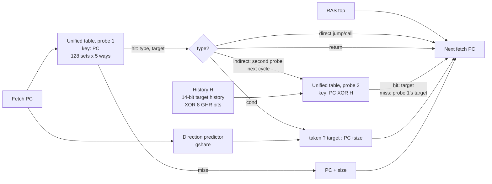

# Section 6: architectural exploration, option C

**Question.** Can one table, indexed by PC, history and branch type, predict
the targets of both direct and indirect branches (and optionally returns)?
What does it cost in aliasing, capacity fragmentation and lookup
dependencies?

The designs below were implemented in the simulator (`pintool/unified.h`,
configurations `uni_*`). Each one replaces the BTB and the indirect target
predictor with a single table. The direction predictor (gshare, 14-bit
history) and the 64-entry RAS are the final design's, so every difference
comes from the target side. Returns keep their RAS: the table only
identifies a return, because a return's target needs a stack, not a table
(that is option A).

## Designs

| Design | Target structures | Target bits | Total bits |
|---|---|---|---|
| `baseline` (spec) | 256-entry direct-mapped BTB | 13,312 | 43,537 |
| `final` (separate) | 256-entry 4-way BTB + 512-entry 4-way indirect predictor (`itp4_gh`) | 35,854 | 92,195 |
| `uni_hist` | one 640-entry table; every lookup keyed by (PC, H), H = target history XOR 8 recent conditional outcomes | 35,214 | 91,555 |
| `uni_phr` | as `uni_hist`, H = target history only | 35,214 | 91,555 |
| `uni_2probe` | one 640-entry table; probe 1 keyed by PC; if that entry is an indirect branch, probe 2 keyed by (PC, H) | 35,854 | 92,195 |

All three unified designs use at most the separate design's target storage,
and `uni_2probe` uses exactly the same.

## Microarchitecture

The figure shows `uni_2probe`. In `uni_hist` and `uni_phr` there is only one
probe: H is hashed into every lookup, so the table returns the type and
target in one step, for every kind of branch.

## Bit-level storage

| Field | Separate BTB entry | Separate indirect predictor entry | Unified entry (`uni_hist`) | Unified entry (`uni_2probe`) |
|---|---|---|---|---|
| valid | 1 | 1 | 1 | 1 |
| kind (PC or context entry) | — | — | — | 1 |
| tag | 16 | 8 | 16 | 16 |
| target (low 32 bits) | 32 | 32 | 32 | 32 |
| type | 3 | — | 3 | 3 |
| LRU age | 2 (4-way) | 2 (4-way) | 3 (5-way) | 3 (5-way) |
| **bits per entry** | **54** | **43** | **55** | **56** |
| entries | 256 | 512 | 640 | 640 |
| path history register | — | 14 | 14 | 14 |
| **total** | 13,824 | 22,030 | **35,214** | **35,854** |

Unifying costs bits per entry. In the separate design, an indirect predictor
entry is only consulted after the BTB has identified the branch by its full
16-bit tag, so it needs just an 8-bit tag (to tell contexts apart) and no
type. In a unified table every entry must identify its branch on its own,
so every entry carries the full tag and the type. The same storage therefore
holds 640 unified entries instead of 768 separate ones (17% fewer).

## Lookup order and dependencies

- **Separate (`final`):** at fetch, the BTB (PC), the indirect predictor
  (PC, H), the direction predictor and the RAS are all read in parallel.
  The BTB's type field then selects the next PC. One step, no serial
  dependency; the indirect predictor's read is wasted for most branches.
- **`uni_hist` / `uni_phr`:** one probe, in parallel with the direction
  predictor and RAS. But the index needs the current history H, which
  depends on the previous branches' predicted outcomes and targets. That
  history update is now on the path to *every* target lookup, not only
  indirect ones: a fetch-loop timing dependency like gshare's, applied to
  the BTB itself.
- **`uni_2probe`:** probe 1 needs only the PC. Only when probe 1 says
  "indirect" does probe 2 follow, using H. That second probe depends on the
  first, so each predicted indirect branch costs an extra lookup step (a
  fetch bubble), unless the table is banked or dual-ported so both can
  proceed together, which brings back much of the separate design's cost.

## Measured results

From `scripts/run_all.sh baseline final uni_hist uni_phr uni_2probe` and
`scripts/print_diagnostics.sh`. All designs have the same direction
predictor and RAS, and at most the same target storage.

**Wrong-next-PC MPKI and geometric-mean speedup over the baseline**

| Design | loop | sort | recurse | interp | gzip | Geomean speedup |
|---|---|---|---|---|---|---|
| `baseline` | 0.699 | 43.169 | 26.873 | 53.175 | 11.441 | 1.0000 |
| `final` (separate) | 0.685 | 42.839 | 21.500 | 1.671 | 10.482 | 1.1357 |
| `uni_hist` | 0.868 | 43.337 | 22.461 | 1.720 | 10.559 | 1.1312 |
| `uni_phr` | 0.818 | 42.893 | 21.596 | 2.702 | 10.483 | 1.1315 |
| `uni_2probe` | 0.682 | 42.838 | 21.499 | 1.670 | 10.461 | 1.1358 |

**Wrong-next-PC MPKI by cause (selected)**

| Cause, workload | `final` | `uni_hist` | `uni_phr` | `uni_2probe` |
|---|---|---|---|---|
| BTB (target missing or wrong), loop | 0.041 | 0.213 | 0.163 | 0.039 |
| BTB, sort | 0.018 | 1.019 | 0.067 | 0.016 |
| BTB, recurse | 0.030 | 0.892 | 0.117 | 0.029 |
| BTB, gzip | 0.028 | 0.106 | 0.026 | 0.005 |
| indirect target, interp | 1.133 | 1.130 | 2.126 | 1.133 |
| return, recurse | 0.010 | 0.411 | 0.027 | 0.010 |

**Table contents at the end of the run (640 entries)**

| Workload, design | Entries holding direct branches | Distinct direct branches | Entries per direct branch | Entries per indirect branch |
|---|---|---|---|---|
| gzip, `uni_hist` | 513 | 186 | 2.76 | 1.64 |
| gzip, `uni_phr` | 533 | 332 | 1.61 | 1.62 |
| gzip, `uni_2probe` | 438 | 438 | 1.00 | 3.12 |
| interp, `uni_hist` | 445 | 278 | 1.60 | 3.04 |
| interp, `uni_phr` | 423 | 296 | 1.43 | 3.39 |
| interp, `uni_2probe` | 359 | 359 | 1.00 | 4.84 |

**Second (dependent) probes in `uni_2probe`:** interp 3,507,021 (52.7 per
thousand instructions); gzip 420 (0.003 per thousand). The other workloads
have only a few hundred indirect branches.

**Aliasing** (`btb_alias_hits`: hits on an entry that belongs to a
different branch or context, counted with shadow copies of the full PC and
context that are not part of the predictor's storage):

| Design | loop | sort | recurse | interp | gzip |
|---|---|---|---|---|---|
| `final` | 0 | 0 | 0 | 0 | 0 |
| `uni_hist` | 1 | 1 | 1 | 1 | 10 |
| `uni_phr` | 1 | 1 | 1 | 2 | 3 |
| `uni_2probe` | 0 | 0 | 0 | 0 | 0 |

### Analysis

- **Aliasing is negligible.** With 16-bit tags, the designs keyed by PC
  (`final`'s BTB, `uni_2probe`'s first probe) had no false hits at all. The
  single-probe designs hash history into the tag, so occasionally an entry
  of another branch or context matches: at most 10 times in gzip's 37
  million lookups, more often where fragmentation causes more misses (each
  would-be miss is a chance for a false match). At these code sizes, a
  16-bit tag makes aliasing irrelevant; larger programs or shorter tags
  would change that. Fragmentation and the dependent lookup, not aliasing,
  separate the designs.
- **Capacity fragmentation (`uni_hist`).** Keying every lookup by history
  gives a branch one entry per history pattern it is seen in. On gzip the
  table held 186 direct branches in 513 entries (2.76 each), against 438
  branches at one entry each in `uni_2probe`. Each new pattern is a cold
  miss, so BTB-miss MPKI rises sharply (sort: 0.018 to 1.019), and loop and
  sort end up slower than the baseline. Returns suffer too (recurse: 0.010
  to 0.411 MPKI): the RAS holds the right address, but the table no longer
  recognizes the instruction as a return in the new context. (Direction-
  cause MPKI falls slightly, because a missing entry makes the front end
  fall through, which happens to be right for some mispredicted not-taken
  branches.)
- **One history can't serve both kinds of branch (`uni_phr`).** Target
  history changes only at indirect branches, so fragmentation drops (gzip:
  1.61 entries per direct branch) and BTB misses return to `final`'s level.
  But interp's indirect MPKI rises from 1.13 to 2.13, exactly `itp4`'s
  figure without conditional outcomes. The history that indirect branches
  need is the one that fragments direct branches.
- **Two probes match the separate design's accuracy (`uni_2probe`).** With
  the same storage as `final`, it gives the same results on interp and
  slightly better on gzip (BTB misses 0.005 vs 0.028 MPKI): gzip has almost
  no indirect branches, so `final`'s 512-entry indirect predictor mostly
  sits idle, while the unified table gives that space to direct branches.
  Sharing capacity between branch types is unification's main advantage.
- **Lookup dependency.** The cost is the second probe, which can only start
  after the first has returned the type. interp needs 52.7 second probes per
  thousand instructions. At one fetch cycle each, that adds 0.053 to its CPI,
  three times the CPI cost of all its remaining indirect mispredictions
  (1.133 MPKI x 15 / 1000 = 0.017). Counting that cycle, interp's CPI goes
  from 1.0251 to about 1.078 and `uni_2probe`'s geometric-mean speedup from
  1.136 to about 1.124, below `final`. For gzip the cost is negligible.

### Comparison with the baseline and conclusion

Every unified design beats the spec's baseline overall (geometric-mean
speedups 1.131 to 1.136), but only because it also includes the indirect,
direction and RAS improvements; the fair comparison is with `final` at equal
storage. Against `final`:

- A single history-keyed table is worse: fragmentation costs more than
  sharing gains, and no one history suits both direct and indirect branches.
- A two-probe table matches the separate design's accuracy with the same
  bits and shares capacity better, but serializes the lookup of every
  indirect branch.

So a unified target predictor is the better choice when the mix of direct
and indirect branches varies widely between programs (capacity sharing
pays) and either indirect branches are rare or the second probe can be
hidden, for example by a banked or dual-ported table, which gives back part
of the savings. When indirect branches are frequent, as in interpreters,
separate structures probed in parallel are faster for the same storage.
